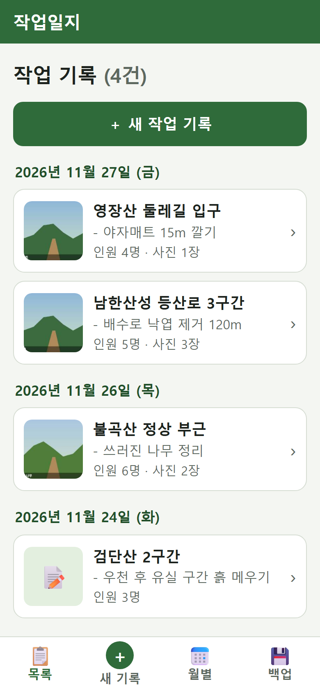
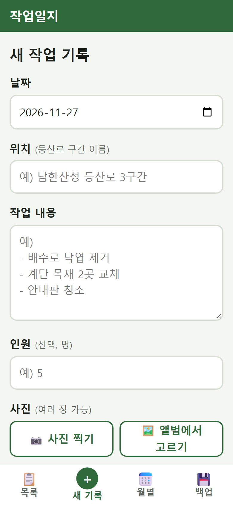
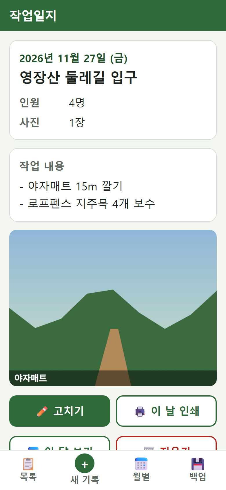
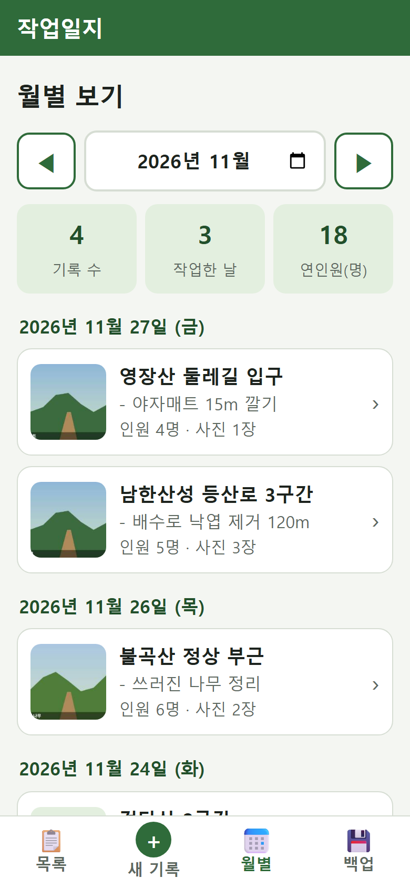

# 작업일지

등산로 정비 현장에서 **휴대폰으로 쓰는 작업일지**입니다.
날짜, 위치(등산로 구간), 작업 내용, 인원, 사진을 기록하고, 월별로 모아 보고, 하루치를 A4로 인쇄할 수 있습니다.

- 회원가입·로그인 없음, 인터넷 서버 없음
- 기록과 사진은 **그 휴대폰(그 브라우저) 안에만** 저장됩니다
- 사진은 저장하기 전에 자동으로 크기를 줄여서(긴 변 1600픽셀) 공간을 아낍니다

| 목록 | 새 기록 | 자세히 보기 | 월별 보기 |
|---|---|---|---|
|  |  |  |  |

## 할 수 있는 것

| 메뉴 | 하는 일 |
|---|---|
| **목록** | 기록이 최신순으로 날짜별로 묶여서 보입니다. 누르면 자세히 볼 수 있습니다. |
| **새 기록** | 날짜(기본은 오늘), 위치, 작업 내용, 인원, 사진을 적고 **저장**. 사진은 "사진 찍기"(카메라) 또는 "앨범에서 고르기"(여러 장)로 넣습니다. |
| **자세히 보기** | **고치기**, **지우기**(한 번 더 물어봄), **이 날 인쇄** |
| **월별** | ◀ ▶ 로 달을 넘기며 그 달 기록 수, 작업한 날 수, 연인원을 봅니다. |
| **백업** | 전체 기록을 파일(.json)로 **내려받기**, 그 파일을 다시 **불러오기** |
| **인쇄** | 하루치 기록을 A4 한 장 양식(작성/확인 칸 포함)으로 인쇄하거나 PDF로 저장 |

## ⚠️ 꼭 알아 두세요: 백업

기록은 휴대폰 브라우저 안에만 있습니다. 아래 경우에는 **기록이 사라질 수 있습니다.**

- 휴대폰을 바꾸거나 초기화할 때
- 브라우저의 "인터넷 기록/사이트 데이터 삭제"를 할 때
- 아이폰 사파리에서 오랫동안(약 7일 이상) 열지 않았을 때 → **홈 화면에 추가**해서 쓰면 이 문제가 줄어듭니다

그래서 **일주일에 한 번은 [백업] → [백업 파일 내려받기]** 를 눌러 파일을 받아 두고,
카카오톡 "나와의 채팅"이나 컴퓨터에 보관하세요. 새 휴대폰에서는 [백업] → [백업 파일 불러오기]로 되돌립니다.

> 같은 주소라도 **크롬과 삼성 인터넷은 기록을 따로 보관**합니다. 늘 같은 브라우저로 여세요.

---

## 1. 컴퓨터에서 열어 보기

1. 이 저장소 GitHub 화면에서 초록색 **Code** 버튼 → **Download ZIP** 을 누릅니다.
2. 받은 ZIP 파일을 마우스 오른쪽 버튼 → **압축 풀기** 합니다.
3. 풀린 폴더 안의 **`index.html`** 을 더블클릭합니다. 크롬이나 엣지에서 작업일지가 열립니다.

컴퓨터에서 쓴 기록은 그 컴퓨터에만 저장됩니다. 휴대폰 기록을 컴퓨터로 옮기려면 휴대폰에서 백업 파일을 내려받아 컴퓨터의 [백업] → [불러오기]로 넣으세요.

## 2. 휴대폰에서 쓰기 (GitHub Pages 켜기)

GitHub Pages를 켜면 작업일지가 **인터넷 주소**를 갖게 되어 휴대폰에서 바로 열 수 있습니다. (무료, 한 번만 하면 됩니다.)

### 가. GitHub Pages 켜기 (컴퓨터에서)

1. 컴퓨터 브라우저로 GitHub에 로그인하고 이 저장소(`my-project`) 화면을 엽니다.
2. 위쪽 메뉴 맨 오른쪽의 **⚙️ Settings**(설정)를 누릅니다.
3. 왼쪽 메뉴에서 **Pages** 를 누릅니다. (Code and automation 묶음 안에 있습니다)
4. **Build and deployment** 아래 **Source** 가 **Deploy from a branch** 인지 확인합니다.
5. 그 아래 **Branch** 에서 `None` 으로 된 칸을 눌러 **`main`** 을 고르고, 옆 칸은 **`/ (root)`** 그대로 둔 채 **Save** 를 누릅니다.
6. 1~2분 기다린 뒤 이 Pages 화면을 새로고침하면 위쪽에
   **"Your site is live at https://hongyoungjean-afk.github.io/my-project/"** 처럼 주소가 나타납니다.
   이 주소가 작업일지 주소입니다.

> 저장소가 **비공개(Private)** 이면 무료 계정에서는 Pages가 켜지지 않을 수 있습니다.
> 그럴 때는 Settings 첫 화면 맨 아래 **Danger Zone → Change visibility → Public** 으로 바꿔야 합니다.
> 공개로 바꿔도 **기록과 사진은 휴대폰 안에만 있으므로 남에게 보이지 않습니다.** (공개되는 것은 프로그램 코드뿐입니다.)

### 나. 휴대폰에서 열고 홈 화면에 추가하기

위 주소를 카카오톡 "나와의 채팅"으로 보내 두면 휴대폰에서 누르기 편합니다.

**안드로이드 (크롬)**
1. 크롬으로 주소를 엽니다. (카톡 안에서 열렸다면 오른쪽 위 ⋮ → **다른 브라우저로 열기** → 크롬)
2. 오른쪽 위 **⋮** → **홈 화면에 추가** (또는 **앱 설치**) → **추가**
3. 이제 홈 화면의 **작업일지** 아이콘으로 엽니다.

**아이폰 (사파리)**
1. 사파리로 주소를 엽니다. (카톡 안에서 열렸다면 오른쪽 아래 사파리 아이콘을 눌러 사파리로 열기)
2. 아래쪽 가운데 **공유 버튼(네모에 위쪽 화살표)** → **홈 화면에 추가** → **추가**
3. 이제 홈 화면의 **작업일지** 아이콘으로 엽니다.

> 주의: 홈 화면 아이콘으로 연 작업일지와 사파리/크롬에서 주소로 연 작업일지는 기록을 따로 보관할 수 있습니다. **한 가지 방법(홈 화면 아이콘)으로만** 쓰는 것이 좋습니다.

### 다. 처음 쓸 때 해 볼 것

1. 아래 **＋ 새 기록** → 위치와 작업 내용을 적고 **📷 사진 찍기** 로 사진 1장 → **저장**
2. **목록** 에 방금 기록이 보이는지 확인
3. 기록을 눌러 **고치기** 로 인원을 바꿔 보기
4. **월별** 에서 이번 달 기록 수 확인
5. **이 날 인쇄** → 인쇄 화면에서 **PDF로 저장** 해 보기
6. **백업** → **백업 파일 내려받기** 로 파일이 받아지는지 확인

---

## 파일 구성 (참고)

| 파일 | 내용 |
|---|---|
| `index.html` | 화면 뼈대 |
| `style.css` | 모양(글자 크기, 색, 인쇄 양식) |
| `app.js` | 저장·사진 줄이기·월별 보기·백업 등 모든 동작 |
| `manifest.webmanifest`, `icon*` | 홈 화면 아이콘 |
| `docs/screenshots/` | 이 설명서의 화면 사진 |

별도 설치나 빌드 과정이 없는 순수 HTML/CSS/JavaScript 입니다. 기록은 브라우저의 IndexedDB에 저장됩니다.
